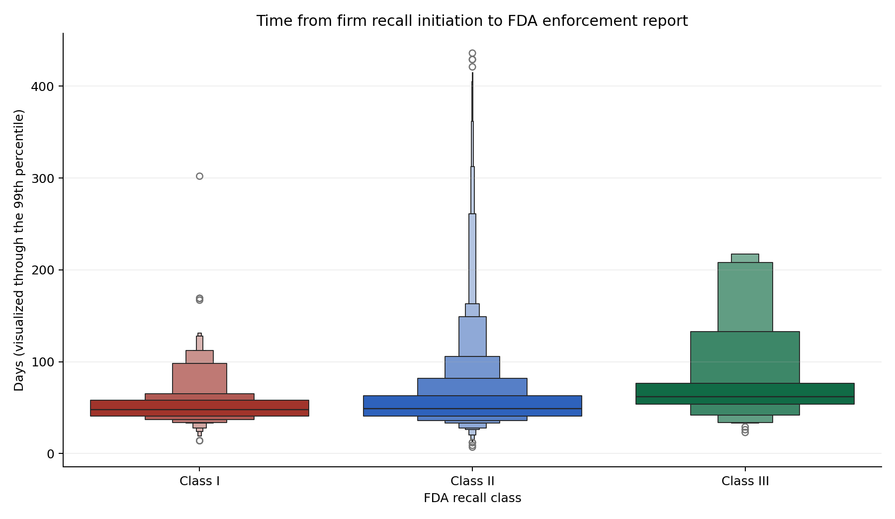
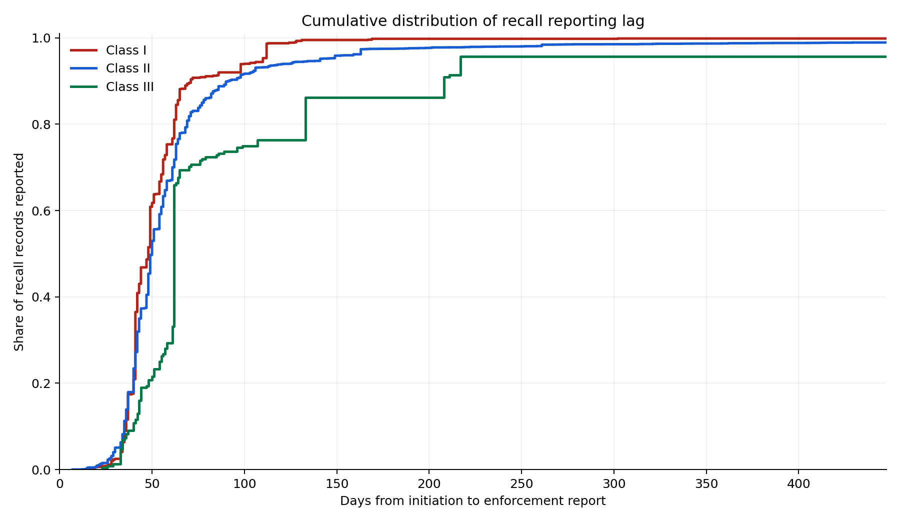
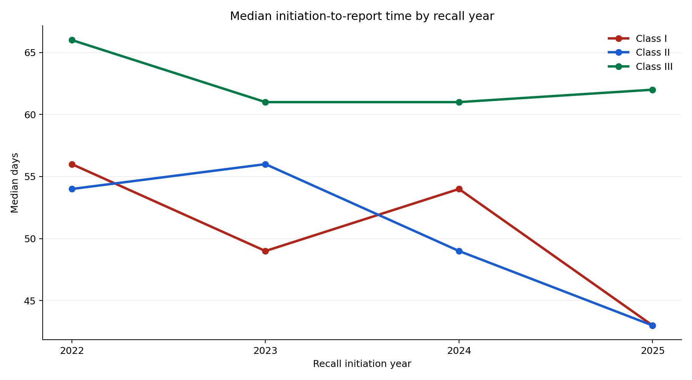

# FDA Medical-Device Recall Response Timelines


**Decision question:** How much time elapsed between firm initiation of a medical-device recall and publication in an FDA Enforcement Report, and how did the observed distribution vary by FDA recall class from 2022 through 2025?

This project treats publication lag as an operational surveillance measure. It does **not** measure the speed of product correction, recall effectiveness, patient harm, or FDA performance. The executed Python/DuckDB workflow is paired with a substantive SAS 9.4/SAS Studio validation program.

## Executive summary

I analyzed **11,005 device recall records** initiated during 2022–2025 from the FDA's openFDA enforcement-report export.

- Median initiation-to-report time was **48 days for Class I**, **50 days for Class II**, and **62 days for Class III** records.
- The distributions differed statistically (Kruskal–Wallis H = **125.17**, p < 0.001), but the effect size was **small** (epsilon-squared = **0.011**). Recall class alone explains little of the rank variation in reporting lag.
- For Class I and II records, the median fell to **43 days in 2025**, from 56 and 54 days, respectively, in 2022. This is a descriptive cohort comparison, not evidence that a policy or process caused improvement.
- Class III estimates are less stable because that group contained only **232 records**, compared with 1,452 Class I and 9,321 Class II records.



## Why this matters

Enforcement reports are a public communication layer in the recall process. Understanding the time between a firm's initiation date and FDA report publication helps surveillance teams distinguish the underlying recall action from when it becomes visible in this particular public dataset. The analysis demonstrates clinical-data operations skills: source interpretation, date validation, non-normal distributions, effect-size reporting, and careful limits on inference.

## Methods at a glance

1. Download the official openFDA device-enforcement bulk export and retain records initiated from January 1, 2022 through December 31, 2025.
2. Use DuckDB SQL to type dates, construct three operational intervals, classify recall narratives for descriptive review, and write QA results.
3. Exclude records with missing or negative initiation-to-report intervals from the primary comparison. None of the 11,005 classified records met those exclusion criteria.
4. Summarize median, interquartile range, mean, and 90th percentile by recall class.
5. Use a Kruskal–Wallis test because the delay distributions are right-skewed; report epsilon-squared to separate statistical detectability from practical magnitude.
6. Independently reproduce the analytic cohort, QA, grouped statistics, tie-corrected Kruskal–Wallis calculation, effect size, annual medians, chart, and exports in SAS.

Full details: [methodology](docs/METHODOLOGY.md) · [data dictionary](docs/DATA_DICTIONARY.md) · [references](docs/REFERENCES.md)

## Results

| FDA class | Records | Median days | IQR, days | 90th percentile |
|---|---:|---:|---:|---:|
| Class I | 1,452 | 48 | 41–58 | 71 |
| Class II | 9,321 | 50 | 41–63 | 91 |
| Class III | 232 | 62 | 55–101 | 208 |





## Data quality

The automated QA layer found:

- 11,006 source records in the date window
- 11,005 records with a valid FDA class for analysis
- zero duplicate recall numbers
- zero missing recall numbers
- one missing classification date
- zero classification dates before initiation
- zero report dates before initiation

The primary outcome uses initiation and report dates, so the single missing classification date does not remove that record from the main analysis.

## Reproduce the project

Python 3.12 is recommended.

```bash
python -m venv .venv
# Windows: .venv\Scripts\activate
# macOS/Linux: source .venv/bin/activate
pip install -r requirements.txt
python src/acquire_openfda.py
python src/analyze.py
pytest -q
```

### SAS validation

The complete program is in [`sas/run_all.sas`](sas/run_all.sas). It performs explicit typed import, inclusion checks, duplicate and date QA, grouped descriptive analysis, a transparent rank-based Kruskal–Wallis calculation with tie correction, epsilon-squared, an HTML report, visualization, and CSV export.

1. Upload or clone the repository into SAS Studio or another SAS 9.4 environment.
2. Change the `project_root` macro variable in `sas/run_all.sas`.
3. Run the complete program.
4. Run `python src/validate_sas_outputs.py` locally to compare 22 SAS values with the independent Python reference.

SAS is not installed in the development environment used for this release, so the program was statically reviewed and its formulas were independently reproduced in Python; generated SAS output is not claimed until it is executed in SAS. See the [SAS run guide](sas/README.md).

The acquisition script downloads the current official bulk export. Because FDA updates the source, a later run may not reproduce the exact snapshot totals shown here. The committed [download manifest](data/raw/download_manifest.json) records the export date and source URL used for this analysis.

## Repository structure

```text
├── data/
│   ├── raw/download_manifest.json
│   └── processed/recall_analysis.csv
├── docs/
│   ├── DATA_DICTIONARY.md
│   ├── METHODOLOGY.md
│   ├── REFERENCES.md
│   ├── WEBSITE_CASE_STUDY.md
│   └── LINKEDIN_POST.md
├── outputs/
│   ├── figures/
│   └── tables/
├── sql/01_build_analysis.sql
├── sas/
│   ├── run_all.sas
│   └── README.md
├── src/
│   ├── acquire_openfda.py
│   ├── analyze.py
│   └── validate_sas_outputs.py
└── tests/test_outputs.py
```

## Interpretation boundaries

- An enforcement-report date is not the date a patient, clinician, distributor, or health system first learned of a recall.
- Records represent recalled products, not necessarily independent recall events; a single event can include multiple recall numbers.
- FDA class reflects relative health hazard, not the number of injuries or deaths.
- Narrative reason groups are transparent keyword categories for portfolio demonstration, not validated FDA root-cause classifications.
- The analysis is descriptive and associational. It does not evaluate agency or manufacturer performance.

## Ethics and privacy

This project uses public, product-level regulatory data. It contains no protected health information, patient records, confidential employer information, or proprietary Texas DSHS data. Firm names are retained only because they are part of the public FDA record and are not used for performance ranking.

## Author

**Kira Gor, BDS, MPH**  
Epidemiology · healthcare and clinical data analytics · SAS, Python, SQL · reproducible QA/QC

## License

Code is released under the [MIT License](LICENSE). FDA source data remain subject to the [openFDA terms and license](https://open.fda.gov/license/).
